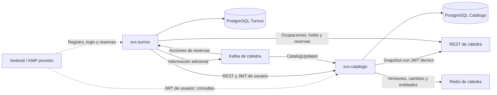

# Arquitectura y límites

## Responsabilidades

Catálogo mantiene la copia PostgreSQL de categorías, profesionales y horarios semanales, su versión aplicada y el diagnóstico de sincronización. Resuelve búsquedas exclusivamente locales y proporciona a Turnos el profesional y su agenda. REST, Redis y Kafka de cátedra son fuentes de sincronización, no dependencias de cada búsqueda.

No administra usuarios, contraseñas, ocupaciones, holds ni reservas. Turnos autentica usuarios, consume Catálogo mediante REST y coordina reservas con la cátedra. Cada backend administra su propia base y migraciones; no existen consultas cruzadas a tablas ni repositorios compartidos.

Fuentes normativas locales: `PROJECT_STATEMENT-v1 (1).md` §§3–6, 8–12 e `INTEGRATION_REFERENCE-v2 (1).md` §§2–7, 14–16 y 18–19, ubicadas fuera de este repositorio en `referencia-catedra`. El archivo de integración se identifica como v2 por su nombre, aunque conserva un encabezado interno «Contrato v1 para revisión docente»; los mensajes Kafka especifican `schemaVersion: 1`. No se presume otra versión no disponible.

## Vista general

Las conexiones KMP son previstas; no acreditan un cliente móvil terminado o verificado por este repositorio. Los flujos de reservas y el modelo detallado de Turnos pertenecen a su documentación. Catálogo no procesa eventos de reservas.

El Compose conecta solo el backend a `default` e `integracion`; la red externa se llama `backends-integracion`. PostgreSQL permanece en `default`. La comunicación con Turnos utiliza el DNS Docker `svc-catalogo:8080`, sin publicar HTTP fuera de loopback ni compartir bases.

## Organización hexagonal

Raíz: [catalogo](../src/main/java/com/example/svccatalogo/catalogo).

- `domain/model`: modelos e invariantes, sin dependencias Spring, JPA, Redis o Kafka.
- `domain/ports/in`: contratos de entrada a los casos de uso; `domain/ports/out`: abstracciones de persistencia y fuentes externas.
- `application/usecases`: casos de uso y coordinación. Utiliza Spring para inyección y transacciones, manteniendo las entidades y DTO tecnológicos en infraestructura.
- `infrastructure`: controladores, DTO, mappers, seguridad, clientes REST/Redis, consumidor Kafka, persistencia JPA, inicialización y decoradores diagnósticos.

| Entrada / responsabilidad | Implementación de aplicación | Puertos de salida / adaptadores |
| --- | --- | --- |
| `BuscarProfesionalesPort` | `BuscarProfesionalesUseCase` | `ProfesionalRepositoryPort`, `HorarioSemanalRepositoryPort`; adaptadores JPA. |
| `ConsultarProfesionalPort`, `ConsultarHorariosProfesionalPort` | `ConsultarProfesionalUseCase`, `ConsultarHorariosProfesionalUseCase` | Repositorios de profesional, categoría y horarios. |
| `ConsultarEstadoSincronizacionPort` | `ConsultarEstadoSincronizacionUseCase` | `EstadoSincronizacionRepositoryPort`. |
| `SincronizarCatalogoPort`, `AplicarSnapshotCatalogoPort` | `SincronizarCatalogoUseCase`, `AplicarSnapshotCatalogoUseCase` | `CatalogoRemotoPort` → `CatalogoRestClientAdapter`; `CatalogoSnapshotPersistencePort` → `CatalogoSnapshotPersistenceAdapter`. |
| `SincronizarCatalogoIncrementalPort` | `SincronizarCatalogoIncrementalUseCase` | `CatalogoRedisPort` → `CatalogoRedisAdapter`; `CatalogoIncrementalPersistencePort` → `CatalogoIncrementalPersistenceAdapter`. |
| `ProcesarNotificacionCatalogoUseCase` | `ProcesarNotificacionCatalogoService` | `EventoCatalogoProcesadoPort` y puertos de estado/sincronización. |
| `ReconciliarCatalogoPort` | `ReconciliarCatalogoUseCase` | Estado con bloqueo, sincronización incremental y Redis. |

Los adaptadores de entrada dependen de los [puertos](../src/main/java/com/example/svccatalogo/catalogo/domain/ports), no de repositorios Spring Data. Los [casos de uso](../src/main/java/com/example/svccatalogo/catalogo/application/usecases) dependen de abstracciones; los mappers separan modelos, entidades y contratos JSON.

`DiagnosticoSincronizacionConfiguration` declara decoradores `@Primary` para sincronización completa, incremental, notificaciones y reconciliación. Envuelven los delegados transaccionales para registrar el resultado exterior, incluso tras rollback. La coordinación y sus límites se detallan en [sincronización](sincronizacion-y-kafka.md).

## Trazabilidad de PROJECT_STATEMENT §12

| Requisito documental aplicable | Ubicación |
| --- | --- |
| Requisitos, configuración y ejecución reproducible | [README](../README.md), [operación](seguridad-y-operacion.md). |
| Diagrama general con KMP, servicios, bases e integraciones | Vista general anterior, con KMP previsto. |
| Operaciones, DTO, autenticación y errores entre servicios | [Contratos](contratos.md). |
| Modelo y propiedad de datos | [Modelo de Catálogo](modelo-datos.md); Turnos conserva usuarios/procesos de reserva en su base y documenta su esquema en su repositorio. |
| Sincronización completa e incremental | [Sincronización y Kafka](sincronizacion-y-kafka.md). |
| Idempotencia y recuperación | Mismo documento, con límites explícitos. |
| Seguridad y autorización | [Seguridad y operación](seguridad-y-operacion.md). |
| Ejecución de pruebas | [Pruebas](pruebas.md). |
