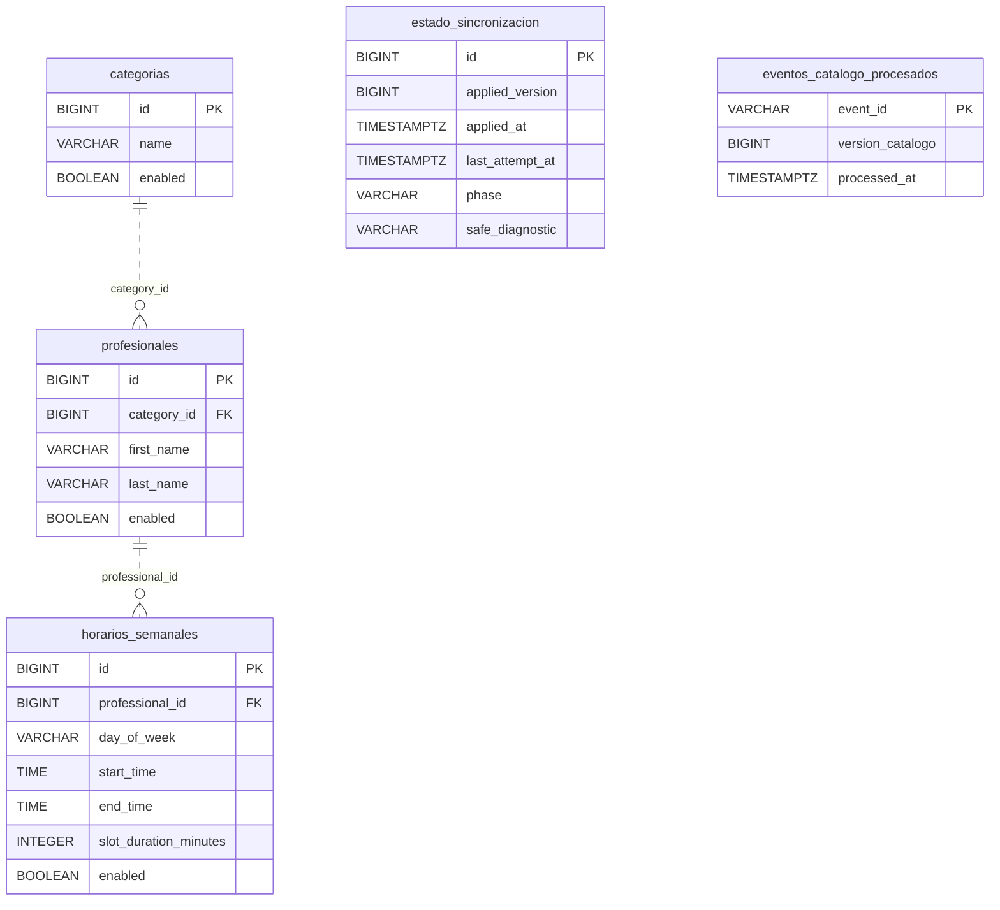

# Modelo de datos y propiedad

## Persistencia local

Las [migraciones Flyway](../src/main/resources/db/migration) definen el esquema. Hibernate utiliza `ddl-auto=validate`: valida el modelo persistente, sin sustituir las migraciones. `spring.jpa.open-in-view=false` evita mantener la sesión de persistencia durante la respuesta web.

Cada profesional pertenece obligatoriamente a una categoría; cada horario, a un profesional. Las relaciones no son identificadoras: los IDs de las entidades son PK independientes. Estado y eventos no tienen FK hacia las entidades del catálogo. Los modelos de dominio no contienen asociaciones JPA; los adaptadores/mappers convierten IDs y campos a las [entidades de infraestructura](../src/main/java/com/example/svccatalogo/catalogo/infrastructure/persistence/entity).

## Tablas y restricciones

| Tabla | Reglas principales |
| --- | --- |
| `categorias` | ID externo positivo; `name` obligatorio hasta 255 y no blanco; `description` opcional; `enabled` obligatorio. |
| `profesionales` | ID externo positivo; FK `category_id`; nombre y apellido obligatorios hasta 255 y no blancos; `enabled` obligatorio. |
| `horarios_semanales` | ID externo positivo; FK `professional_id`; día enum `MONDAY`–`SUNDAY`; inicio anterior al fin; duración positiva; `enabled` obligatorio. No hay unicidad por profesional/día, por lo que admite varias jornadas. |
| `estado_sincronizacion` | Una fila identificada por `id=1`. Versión nula antes del primer snapshot o no negativa; fases admitidas `NOT_STARTED`, `IN_PROGRESS`, `SUCCESS`, `ERROR`. |
| `eventos_catalogo_procesados` | `event_id` no blanco, máximo 255 y PK; versión no negativa; `processed_at` obligatorio, predeterminado a la hora de PostgreSQL. |

Las tres entidades del catálogo conservan `created_at` y `updated_at` externos opcionales, de tipo `TIMESTAMP WITH TIME ZONE`. No se generan IDs locales para reemplazar los IDs centrales. Una baja lógica se representa con `enabled=false`; no se elimina una entidad solo por estar deshabilitada.

No se persisten ocupaciones, usuarios, hashes, holds ni reservas. Turnos administra esos datos propios en su base; los IDs que intercambia con Catálogo no crean relaciones entre bases. Redis es fuente externa de sincronización, no la persistencia principal local.

## Estado válido y último intento

[EstadoSincronizacion](../src/main/java/com/example/svccatalogo/catalogo/domain/model/EstadoSincronizacion.java) y su DTO distinguen:

- `appliedVersion` / `appliedAt`: versión y fecha del último catálogo aplicado correctamente.
- `lastAttemptAt`: finalización del último intento diagnosticado; no es necesariamente su instante de inicio.
- `phase` / `safeDiagnostic`: resultado diagnóstico persistido, sin causas externas potencialmente sensibles.

El esquema admite `IN_PROGRESS`, pero los flujos actuales no mantienen un marcador durable de inicio por cada ejecución. Inicializan `NOT_STARTED` y registran resultados `SUCCESS`/`ERROR`. Una fase exitosa no demuestra que Redis siga en la misma versión en un instante posterior.

Un error de sincronización puede dejar una versión válida aplicada y `phase=ERROR`: no hay contradicción. La versión identifica datos confirmados; el diagnóstico identifica el resultado del intento. Un intento exitoso posterior actualiza el diagnóstico sin inventar una nueva versión. Si PostgreSQL no permite registrar el diagnóstico, este puede quedar desactualizado; el fallo se informa en logs seguros.

## Actualización y migraciones

- **V1 — `V1__crear_tablas_catalogo.sql`:** categorías, profesionales, horarios, estado singleton y valor inicial `NOT_STARTED`.
- **V2 — `V2__crear_tabla_eventos_catalogo_procesados.sql`:** deduplicación durable de notificaciones por `eventId`.

Las migraciones aplicadas no se editan. Flyway las ejecuta al arrancar. Las pruebas de integración usan esquemas PostgreSQL aislados; no requieren modificar manualmente la base de desarrollo.

La sincronización completa reemplaza las tres colecciones en una transacción; la incremental actualiza las entidades afectadas y la versión conjuntamente. El bloqueo pesimista sobre la fila de estado coordina versiones y evita retrocesos. La tabla de eventos se conserva al reemplazar el snapshot. El detalle transaccional y sus límites se documenta en [sincronización y Kafka](sincronizacion-y-kafka.md).
