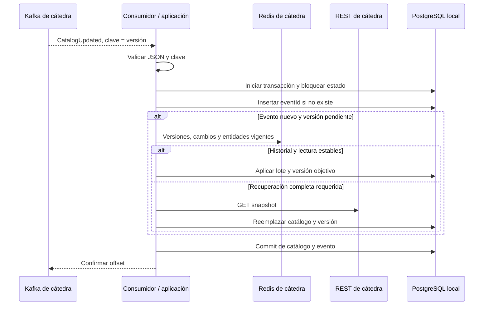

# Sincronización, Kafka e idempotencia

La API de consultas se describe en [contratos](contratos.md); el esquema y significado de versión/diagnóstico, en [modelo de datos](modelo-datos.md).

## Sincronización completa

1. `SincronizarCatalogoUseCase` invoca `CatalogoRemotoPort.obtenerSnapshot()`.
2. `CatalogoRestClientAdapter` realiza el GET autenticado de cátedra con timeouts de conexión de 5 s y lectura de 10 s. No implementa login técnico ni reintentos automáticos REST.
3. `CatalogoSnapshotMapper` exige versión y tres colecciones, convierte los campos a modelos y aplica sus invariantes. Las entidades deshabilitadas también se conservan. Colecciones vacías son distintas de campos ausentes o respuesta nula.
4. `AplicarSnapshotCatalogoUseCase` delega en `CatalogoSnapshotPersistenceAdapter.reemplazarCatalogo()`.
5. El adaptador bloquea la fila de estado mediante `PESSIMISTIC_WRITE`. Si el snapshot tiene versión igual o anterior a la aplicada, no reemplaza datos.
6. Para una versión nueva, elimina horarios, profesionales y categorías; inserta categorías, profesionales y horarios, en ese orden. Todo ocurre dentro de una transacción. Las FK y validaciones impiden confirmar referencias inconsistentes.
7. Solo tras persistir las tres colecciones guarda exactamente la versión del snapshot y fecha aplicada. Un fallo revierte el reemplazo y conserva la copia anterior.

La transacción elimina y reconstruye filas de catálogo, no las tablas ni el historial de eventos. No se aplican snapshots antiguos para retroceder la versión.

## Sincronización incremental

`SincronizarCatalogoIncrementalUseCase` utiliza `CatalogoRedisPort`. Las lecturas implementadas por `CatalogoRedisAdapter` son:

| Recurso Redis | Uso |
| --- | --- |
| `catedra:sync:current-version` | Versión objetivo actual, String decimal no negativo. |
| `catedra:sync:oldest-available-version` | Límite de historial disponible. |
| `catedra:sync:changes:{version}` | JSON con `version` y arrays de IDs bajo `changes.professionalCategories`, `professionals`, `weeklySchedules`. |
| `catedra:sync:professional-categories` | Hash: ID decimal → JSON de categoría vigente. |
| `catedra:sync:professionals` | Hash: ID decimal → JSON de profesional vigente. |
| `catedra:sync:weekly-schedules` | Hash: ID decimal → JSON de horario vigente. |

El contrato también define `catedra:sync:metadata`, pero este adaptador consulta las claves de versión individuales; no lee ese hash. No escribe Redis ni utiliza el namespace privado del alumno o las estructuras internas de holds.

Algoritmo efectivo:

1. Sin versión local, utiliza snapshot completo. Si la versión local coincide con Redis, termina sin actualizar entidades. Si la supera, falla sin retrocederla.
2. Si la versión local es menor que `oldest-available-version`, utiliza snapshot.
3. Recorre las versiones pendientes en orden, desde local + 1 hasta objetivo. Reúne los IDs modificados sin repetirlos. Un cambio ausente o una versión no coincidente devuelta por el puerto provoca snapshot.
4. Lee el **estado vigente** de cada ID en los hashes. No obtiene una imagen histórica de cada versión. Una entidad ausente provoca snapshot.
5. Relee `current-version`. Si cambió durante la lectura, descarta lo obtenido y vuelve a intentar. Tras **tres intentos** de obtener una lectura estable, utiliza snapshot.
6. Con lectura estable, `CatalogoIncrementalPersistenceAdapter.aplicarVersion()` bloquea el estado y verifica la versión esperada. Si ya se aplicó la objetivo o una posterior, no repite las escrituras; otra versión local incompatible produce error.
7. Persiste categorías, profesionales y horarios afectados y avanza a la versión objetivo en una sola transacción. Un error revierte todo el lote.

La implementación recorre los cambios en orden, pero **no confirma una transacción por cada versión intermedia**: consolida el conjunto pendiente y su versión objetivo. No conserva snapshots históricos. Las bajas son lógicas (`enabled=false`), conforme al contrato de hashes vigentes.

Un error de conexión o contenido inválido de Redis se propaga; no toda falla desencadena snapshot. Por ejemplo, JSON malformado, una versión inválida detectada por el adaptador o un ID incoherente no se transforman en cambios vacíos. La detección de cambios concurrentes es la relectura de versión; no se afirma un snapshot distribuido de Redis.

## Notificaciones Kafka

Topic contractual: `catedra.catalog.{groupId}`, configurado mediante `KAFKA_CATALOGO_TOPIC`; consumer group y brokers son los asignados por la integración. La clave es `newVersion` como texto decimal, no `eventId`. El documento de integración es v2; el **schema del mensaje es 1**.

`CatalogUpdated` contiene `eventId`, `eventType`, `newVersion`, `occurredAt`, `source`, `schemaVersion`. `CatalogoKafkaConsumerAdapter` exige objeto JSON, tipo exacto, schema integral 1, eventId no blanco hasta 255, versión integral no negativa, source no blanco e instante válido. La clave debe coincidir exactamente con la versión. Ignora campos adicionales compatibles. `source` y `occurredAt` se validan, pero no se conservan como un payload durable: el modelo funcional es `NotificacionCatalogo(eventId,nuevaVersion)`.

`ProcesarNotificacionCatalogoService` inserta `eventId` mediante `ON CONFLICT DO NOTHING`, sincroniza si corresponde y exige alcanzar al menos la versión notificada antes del commit. El registro del evento y el catálogo participan de la misma transacción. Si falla, ambos revierten y no se confirma el offset. Un duplicado ya confirmado puede reconocerse y confirmar su offset sin repetir efectos. Una versión antigua con otro eventId se registra sin retroceder el catálogo.

El consumidor utiliza `enable-auto-commit=false`, confirmación `manual_immediate` y `earliest`. `acknowledge()` ocurre después de retornar el caso de uso transaccional, no antes de persistir. `CatalogoKafkaErrorConfiguration` emplea `CommonContainerStoppingErrorHandler`: un error detiene el contenedor listener. No hay reintentos de aplicación Kafka ilimitados, DLT ni inbox de mensajes inválidos; estos requieren corrección operativa antes de reanudar. Un mensaje rechazado durante la conversión o validación de clave no llega al caso de uso decorado: no registra por ese camino un nuevo diagnóstico de sincronización. La deduplicación guarda el primer eventId y versión, sin detectar automáticamente un segundo payload contradictorio con el mismo ID.

## Reconciliación de arranque y concurrencia

`ReconciliacionCatalogoInicioAdapter` escucha `ApplicationReadyEvent` y envía una única ejecución a un executor de un hilo. Es asíncrona, con activación predeterminada; no bloquea indefinidamente el servidor HTTP ni añade una tarea periódica.

`ReconciliarCatalogoUseCase` bloquea la misma fila de estado que las notificaciones, reutiliza la incremental (y sus fallbacks) y comprueba igualdad entre versión aplicada y Redis al finalizar. Una copia vacía obtiene snapshot; una atrasada utiliza historial o snapshot; una actualizada no reescribe entidades, aunque el diagnóstico del intento sí puede actualizarse.

Reconciliación y notificaciones mantienen el bloqueo hasta el commit. El timeout transaccional configurable es `catalogo.sincronizacion.transaction-timeout-seconds`, predeterminado 60 s. **En estos caminos la transacción puede abarcar lecturas Redis y REST**; el timeout y los timeouts de clientes acotan operaciones, sin constituir un plazo global exacto independiente de cada llamada. No se afirma que HTTP ocurra siempre fuera de una transacción.

Si la reconciliación falla, el adaptador informa la clase de excepción, conserva la copia confirmada y permite continuar al servidor. No acredita vigencia. Una versión que cambia antes de la verificación final puede hacer fallar y revertir esa ejecución. No hay un ciclo periódico que garantice recuperar toda notificación perdida durante la misma ejecución del servicio: la reconciliación al reiniciar y nuevas notificaciones proporcionan oportunidades posteriores.

## Diagnóstico durable

`DiagnosticoSincronizacionConfiguration` envuelve los puertos con beans `@Primary`. `DiagnosticoSincronizacionExecutor` evita registrar resultados de cada llamada anidada y registra el resultado exterior después de terminar el delegado transaccional. Si hay una transacción llamadora, espera `afterCompletion`; un rollback posterior no se presenta como éxito.

`EstadoSincronizacionPersistenceAdapter.registrarResultadoIntento()` usa `REQUIRES_NEW` a través del bean de persistencia. Conserva versión y fecha aplicada, y actualiza finalización del intento, fase y texto fijo seguro. Un diagnóstico demorado no sobrescribe otro con fecha posterior. No se persisten mensajes de excepciones externas. Un éxito posterior puede sustituir un ERROR anterior.

El decorador de notificaciones no escribe un SUCCESS por el mero retorno: descartar un duplicado no acredita una sincronización exitosa y no borra un ERROR anterior. Cuando se aplican datos, los adaptadores persistentes registran también su éxito dentro de la transacción.

Si falla exclusivamente el guardado del diagnóstico, el executor registra un error seguro con el nombre de la clase; no convierte una sincronización completada en fallida ni reemplaza la excepción real de sincronización. Si PostgreSQL sigue indisponible, no puede garantizarse diagnóstico durable actualizado. Tampoco existe un marcador de intento en curso que detecte por sí solo la terminación abrupta del proceso antes de registrar un resultado.

## Límites

No se proporciona entrega *exactly once*, reinicio automático del listener, retención/purga automática de eventos procesados ni sincronización periódica. Las consultas locales no se bloquean por un ERROR de diagnóstico y no implementan un umbral de frescura. La disponibilidad local solo describe agenda, no ocupaciones ni reserva definitiva.
